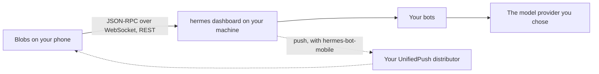

<p align="center">
  
</p>

<h1 align="center">Blobs</h1>

<!-- Keep these two lines in step with the website's headline (site/index.html). -->
<p align="center">
  <b>A mobile client for <a href="https://github.com/NousResearch/hermes-agent">Hermes Agent</a>.</b><br>
  Watch your bots work, answer them when they need you, and take over their screen when it's quicker to do it yourself.
</p>

<p align="center">
  <a href="https://blobs.maddtechnologies.com">Website</a> ·
  <a href="#install">Install</a> ·
  <a href="#connect-your-server">Connect your server</a> ·
  <a href="docs/protocol.md">Protocol notes</a> ·
  <a href="docs/DEVELOPMENT.md">Develop</a>
</p>

<p align="center">
  
  
  
</p>

---

Hermes Agent bots work on their own for hours: they run commands, browse, write files and keep routines. Blobs puts
them on your phone. It keeps the quiet parts quiet and brings you in when it's your turn: a command to approve, a
question to answer, a screen to take over.

Blobs speaks Hermes's own dashboard protocol, the one Hermes Desktop uses, straight to your server. There's no Blobs
server in between, no account and no analytics.

## Features

- **Your bots.** Every bot on your server, with its face, what it's doing and its last word.
- **Live tool activity.** Each tool call is one quiet line as it happens; tap it for the output.
- **Approvals and questions.** Allow or deny a command, choose an option or reply in your own words.
- **Needs you.** One inbox for everything waiting on you, across every bot.
- **Take over the screen.** Watch a bot's desktop live and take the keyboard and mouse when it's stuck.
- **Rooms.** Several bots in one conversation, with @mentions for who should answer.
- **Routines and dashboards.** The jobs each bot runs on a schedule, and panels it keeps up to date for you.
- **Files, voice and more.** Photos, PDFs and voice memos in; math, Mermaid diagrams, documents and spoken replies out.
- **Private push on Android.** Notifications through UnifiedPush and a distributor you choose (ntfy, say), not Firebase.
- **Dark and light.** Follows your phone or your pick; color comes only from the bots' faces and one amber "needs you".

## Install

Blobs is in beta.

| Platform | Where |
| --- | --- |
| iPhone and iPad | TestFlight, opening soon |
| Android | Google Play testing, opening soon |
| From source | [docs/DEVELOPMENT.md](docs/DEVELOPMENT.md) |

The links will appear here and on [blobs.maddtechnologies.com](https://blobs.maddtechnologies.com) as each opens.

## Connect your server

You need a Hermes Agent server your phone can reach. Blobs is tested with **Hermes Agent 0.21.5 and 0.21.6**.

1. On the machine that runs Hermes, start the dashboard on an address your phone can reach. A
   [Tailscale](https://tailscale.com) address keeps it private to your own devices:

   ```bash
   hermes dashboard --no-open --host 100.x.y.z --port 9119
   ```

   Hermes requires a sign-in on any address other than localhost. The first time, it asks you to choose a username and
   password (or set `dashboard.basic_auth` in `~/.hermes/config.yaml` yourself).

2. Open Blobs, enter `http://100.x.y.z:9119` and sign in. The app keeps the session in the phone's keychain and renews
   it itself; it never stores the password.

Taking over a bot's screen needs a Linux host with Hermes's Bot Screen.

### Optional server plugins

Some features need a plugin on the server, from
[blobs-hermes-bot-plugins](https://github.com/Madd-Technologies/blobs-hermes-bot-plugins) (MIT). In the app, **Settings → Server
plugins** shows which ones your server has and gives you the install command for the right version.

| Plugin | Adds |
| --- | --- |
| `hermes-bot-mobile` | Android push through UnifiedPush; live activity in rooms |
| `hermes-dashboard` | Bot dashboards: collections, panels, drafts and buttons |
| `hermes-paperless` | Paperless-ngx documents in the viewer, and a search skill for every bot |
| `hermes-drive` | Google Drive files in the viewer, and a Drive skill |

## How it works



- **One protocol.** Chat, approvals, rooms and the bot screen all run over the dashboard's `/api/ws` JSON-RPC socket
  plus a few REST routes. [docs/protocol.md](docs/protocol.md) documents every method and event the app uses, as
  checked against real servers.
- **Sign-in.** Hermes's password provider through its native PKCE flow. The phone keeps only the access and refresh
  tokens, in SecureStore (Keychain on iOS, Keystore on Android).
- **Built with** Expo SDK 57 and React Native 0.86, TypeScript throughout. The protocol client in `src/lib/hermes`
  has no React Native imports, so its tests run straight in Node.

## Privacy

Blobs collects nothing and talks only to the server you connect it to. The full policy is at
[blobs.maddtechnologies.com/privacy](https://blobs.maddtechnologies.com/privacy.html).

## Project layout

| Path | What's there |
| --- | --- |
| `src/app` | Screens (expo-router) |
| `src/lib/hermes` | The Hermes client: protocol, sign-in, sessions, faces |
| `src/features` | App logic by feature: transcript, inbox, rooms, push, dashboards, viewer… |
| `src/components`, `src/theme` | UI parts and the design tokens |
| `docs/protocol.md` | The Hermes dashboard protocol, as the app uses it |
| `site/` | The website, served by GitHub Pages |
| `scripts/` | Dev server, smoke tests and asset builds |

## Contributing

Issues and pull requests are welcome. Before opening a PR, run `npm run check` (types, lint and the test suite) and
read [docs/DEVELOPMENT.md](docs/DEVELOPMENT.md). Contributions are accepted under the MIT licence.

## Licence

[MIT](LICENSE) © 2026 Madd Technologies LLC.

The licence covers the code. The Blobs name and icon are not part of it, so if you publish your own build, please give
it a different name and icon.

## Acknowledgements

- [Hermes Agent](https://github.com/NousResearch/hermes-agent) by Nous Research (MIT). The face code is ported from
  Hermes Desktop.
- [blobatar](https://www.npmjs.com/package/blobatar) for the faces, [Expo](https://expo.dev) and React Native,
  [Geist](https://vercel.com/font) (SIL OFL 1.1), pdf.js, MathJax and Mermaid.

Blobs is an independent app. It is not affiliated with or endorsed by Nous Research.
