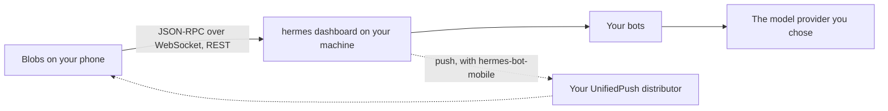

<p align="center">
  
</p>

<h1 align="center">Blobs</h1>

<!-- Keep these two lines in step with the website's headline (site/index.html). -->
<p align="center">
  <b>A mobile client for <a href="https://github.com/NousResearch/hermes-agent">Hermes Agent</a>.</b><br>
  Watch your bots work, answer them when they need you, and take over their screen when it's quicker to do it yourself.
</p>

<p align="center">
  <a href="https://blobs.maddtechnologies.com">Website</a> ·
  <a href="#install">Install</a> ·
  <a href="#connect-your-server">Connect your server</a> ·
  <a href="#using-blobs">Using Blobs</a> ·
  <a href="#check-your-setup">Check your setup</a> ·
  <a href="docs/protocol.md">Protocol notes</a> ·
  <a href="docs/DEVELOPMENT.md">Develop</a>
</p>

<p align="center">
  
  
  
</p>

---

Hermes Agent bots work on their own for hours: they run commands, browse, write files and keep routines. Blobs puts
them on your phone. It keeps the quiet parts quiet and brings you in when it's your turn: a command to approve, a
question to answer, a screen to take over.

Blobs speaks Hermes's own dashboard protocol, the one Hermes Desktop uses, straight to your server. There's no Blobs
server in between, no account and no analytics.

## Features

- **Your bots.** Every bot on your server, with its face, what it's doing and its last word.
- **Live tool activity.** Each tool call is one quiet line as it happens; tap it for the output.
- **Approvals and questions.** Allow or deny a command, choose an option or reply in your own words.
- **Needs you.** One inbox for everything waiting on you, across every bot.
- **Side chats, times and replies.** Scratch conversations next to a bot's main chat; drag left to see when each message
  was sent, pull one right to reply to it.
- **Take over the screen.** Watch a bot's desktop live, take the keyboard and mouse when it's stuck, type with your
  phone's keyboard and paste from your clipboard.
- **Rooms.** Several bots in one conversation, with @mentions for who should answer.
- **Routines and dashboards.** The jobs each bot runs on a schedule, and panels it keeps up to date for you.
- **Files, voice and more.** Photos, PDFs and voice memos in; math, Mermaid diagrams, documents and spoken replies out.
- **Voice calls and phone errands.** Talk with a bot on a voice call, or have it phone a business for you through your
  own number, each call approved by you first (Android, with server plugins).
- **Bot settings in your pocket.** Model, skills, tools, approvals, instructions, look, its keys and where its commands
  run.
- **Private push on Android.** Notifications through UnifiedPush and a distributor you choose (ntfy, say), not Firebase.
- **Dark and light.** Follows your phone or your pick; color comes only from the bots' faces and one amber "needs you".

## Install

Blobs is in beta.

| Platform | Where |
| --- | --- |
| iPhone | TestFlight, opening soon |
| Android | Google Play testing, opening soon |
| From source | [docs/DEVELOPMENT.md](docs/DEVELOPMENT.md) |

The links will appear here and on [blobs.maddtechnologies.com](https://blobs.maddtechnologies.com) as each opens.

## Connect your server

You need a Hermes Agent server your phone can reach. Blobs is tested with **Hermes Agent 0.21.5, 0.21.6 and 0.22.4**.

1. On the machine that runs Hermes, start the dashboard on an address your phone can reach. A
   [Tailscale](https://tailscale.com) address keeps it private to your own devices:

   ```bash
   hermes dashboard --no-open --host 100.x.y.z --port 9119
   ```

   Hermes requires a sign-in on any address other than localhost. The first time, it asks you to choose a username and
   password (or set `dashboard.basic_auth` in `~/.hermes/config.yaml` yourself).

2. Open Blobs, enter `http://100.x.y.z:9119` and sign in. The app keeps the session in the phone's keychain and renews
   it itself; it never stores the password.

Taking over a bot's screen needs a Linux host with Hermes's Bot Screen.

### Optional server plugins

Some features need a plugin on the server, from
[blobs-hermes-bot-plugins](https://github.com/Madd-Technologies/blobs-hermes-bot-plugins) (MIT). In the app, **Settings → Server
plugins** shows which ones your server has and gives you the install command for the right version.

| Plugin | Adds |
| --- | --- |
| `hermes-bot-mobile` | Android push through UnifiedPush; live activity in rooms; changes pushed to the app; restarting Hermes from the app |
| `hermes-dashboard` | Bot dashboards: collections, panels, drafts and buttons (one copy in each bot that keeps a dashboard) |
| `hermes-paperless` | Paperless-ngx documents in the viewer, and a search skill for every bot |
| `hermes-drive` | Google Drive files in the viewer, and a Drive skill |
| `hermes-voice` | Voice calls with your bots (Grok voice, Android) |
| `hermes-phone` | Phone errands through your own Twilio number (US and Canada) |

Plugins load when Hermes starts. After your bot installs or updates one, restart Hermes: **Settings → Restart Hermes**, or
restart its dashboard and gateway services yourself.

## Using Blobs

### Home

- Along the top: your server (Settings), search, **Bot screens**, and **+** for a new bot or room.
- When something waits on you, a card says how many things need you and lists them. **Review all** opens them one card
  at a time: answer each right on the card, swipe up for the next.
- With `hermes-dashboard`, your pinned bots' dashboards sit below as tiles. Then every bot and room, most recent first.
  An amber dot always means it's your turn.

### Chat with a bot

- Tap a bot and write. The button on the right is the mic while the field is empty, send while you type, and stop while
  the bot works.
- **+** attaches photos, files or a picture from your clipboard. The mic records a voice message and writes it out for
  you to send (your server needs speech to text set up).
- Type `/` for your server's commands and the bot's skills.
- Each tool step is one quiet line; tap it for the output. Files and links a bot names open in the viewer.
- Drag the conversation left to see when each message was sent. Pull a message right to reply to it: your message
  quotes it.
- In the header: the bot's dashboard, its chats (**New side chat** starts a separate scratch conversation and leaves the
  main chat as it was) and its screen. Tap the bot's name for its details.

### Answer approvals and questions

- **Approvals:** **Allow** or **Deny**; **⋯** has **Allow for this session** and **Always allow this**. An approval left
  unanswered expires on the server after a few minutes.
- **Questions:** tap a choice, or **Reply…** in your own words.
- **Secrets and sudo passwords:** typed once and sent to your server. The phone never keeps them.

### Rooms

- **+** → **New room**, pick 2 to 6 bots, name it.
- A message with no @mention asks every bot. @name a bot and only the bots you name are asked; the tray says so while you
  write ("Only Juniper is asked"). Another bot joins when one of them @mentions it.
- A bot with nothing to add says so in a quiet line. Bots go at most three rounds for each message of yours, then wait
  for you.
- **⋯** stops the replies or disbands the room.

### Take over a bot's screen

Needs a Linux server with Hermes's Bot Screen.

- **Bot screens** on Home, or the screen button in a chat. Watching never interrupts the bot.
- **Take over**, then tap to click, hold to right-click and drag two fingers to scroll. The keyboard button brings up your
  phone's keyboard with a row of extra keys (esc, tab, ctrl, alt, super, the arrows and enter). Your keyboard's own Enter
  sends Enter too.
- **⋯** → **Paste from clipboard** types your phone's clipboard out on the screen. **⋯** also zooms to actual size or fits
  the whole screen.
- **Hand back** when you're done. If the bot was waiting for you, it's told to carry on.

### Routines

**Details → Routines** lists the jobs a bot runs on a schedule, with the next run and the last result. Pause, resume,
**Run now**, and read past runs. **New routine** opens the chat with a request for the bot to set one up.

### Dashboards

Needs `hermes-dashboard`.

- Ask a bot in its chat ("Keep a dashboard of my open invoices") and it builds the dashboard. Pin the bot
  (**Details → Pin to top**) to see its tiles on Home.
- A panel opens full screen. A record shows its fields (yours to change), its notes and its history. Drafts show in full,
  and a record's buttons put the bot's next step one tap away; the record says the bot is on it until it reports back.
- Swipe a record right when it's done (with Undo), or left to mute it until later. Records that need you also show in
  Needs you.

### A bot's details and your settings

- **Details** (tap the bot's name in its chat): name, description, instructions, look, model, skills, tools, approvals,
  its keys (its own `.env`: values are sent once and never shown again), where its commands run (the server, a container
  on it, or another computer over SSH), voice calls, pin, hide and delete.
- **Settings**: your connection, theme, show thinking, show messages between bots, notifications (Android), server
  plugins, phone errands, restarting Hermes, and the tour.

### Push notifications

Android only for now. Needs `hermes-bot-mobile` and a UnifiedPush distributor app such as ntfy.

**Settings → Notifications → Turn on notifications**, then **Send a test**. You're told when a bot needs you (an
approval, a question, a routine that broke), and tapping the notification opens that chat.

### Voice calls and phone errands

- **Voice calls** (Android, `hermes-voice`): turn them on in **Details → Voice**, then the call button in the chat's
  composer starts one. Real work goes to the bot's chat, and approvals still need a tap.
- **Phone errands** (`hermes-phone`, your own Twilio number, US and Canada): **Settings → Phone** sets the line, what a
  call may say, hours, limits and which bots may call. It dials only your test numbers until you switch it to live. A bot
  writes a call brief, you approve each call, and the report comes back to the bot.

## Check your setup

Run these after you connect, with a bot you don't mind experimenting with (or make one: **+** → **New bot**). Each test says
what it needs; skip the ones whose plugin or platform you don't have.

| # | Test | Do this | You should see |
| --- | --- | --- | --- |
| 1 | Sign in | Enter your server's address and sign in. | Home lists your bots with their faces; the server button has a green dot. |
| 2 | A reply | Open a bot and send `Say hi in five words.` | The reply streams in, and the bot's face shows it working, then idle. |
| 3 | Tool steps | Send `List the files in /tmp.` | One quiet line for the command; tapping it shows the output. |
| 4 | Approval | Send `Make the folder /tmp/blobs-check, then delete it with rm -r.` Tap **Deny** on the card. | An approval card before the delete (if the bot's approvals mode asks: **Details → Approvals**). After Deny, the bot says it couldn't, and the folder stays. Send it again and **Allow** to tidy up. |
| 5 | Needs you | Repeat test 4, and before answering, go back to Home. | A card says 1 thing needs you, with an amber dot. **Review all**, answer it there, and Home clears. |
| 6 | Question | Send `Use the clarify tool to ask me: tea or coffee?` | A card with both choices. Tap one and the bot carries on with it. |
| 7 | Stop | Send `Count to 300, one number per line.` Tap stop while it writes. | It stops within a moment. |
| 8 | Side chat | In the chat's header, open its chats → **New side chat**. Send anything. | A separate conversation. The main chat doesn't show it. |
| 9 | Times and replies | Drag a chat left. Pull a reply right and send something. | Each message's time while you drag. Your message carries a quoted line. |
| 10 | Files and voice | **+** → a photo, with `What's in this picture?` Then tap the mic, speak, and tap the check. | The bot describes the photo (if its model can see pictures). Your words appear in the field, ready to send (if your server has speech to text). |
| 11 | Search | Home → search, and type a word from an earlier message. | Matching bots, rooms and messages; a message opens where it was said. |
| 12 | Rooms | **+** → **New room** with two bots. Send `Each of you say hello in one line.` Then write `@` and one bot's name, `just you this time.` | Both bots answer the first. While you write the second, the tray says only that bot is asked, and only it answers. |
| 13 | Routine | **Details → Routines → New routine**, and ask `Every day at 9:00, remind me to stretch.` | The routine is listed with its next run. **Run now** runs it; pause and resume work. |
| 14 | Dashboard (`hermes-dashboard`) | Ask a bot `Keep a dashboard panel of three books I want to read.` Pin the bot. | A tile on Home. The dashboard opens with the panel, a book opens as a record, and swiping it right marks it done (with Undo). |
| 15 | Bot screen (Linux, Bot Screen) | **Bot screens** → a bot → **Take over**. Tap a text field on its screen, open the keyboard, type `hello` and press Enter. Then **⋯ → Paste from clipboard**. **Hand back**. | Your typing appears on the bot's screen, Enter submits, and your clipboard's text is typed out. Hand back returns the screen to the bot. |
| 16 | Push (Android, `hermes-bot-mobile`, ntfy) | **Settings → Notifications → Turn on notifications → Send a test.** Then send test 4's message and switch away from Blobs before the bot gets to the delete. | The test notification, then one asking for your OK. Tapping it opens that chat. |
| 17 | Server plugins | **Settings → Server plugins.** | Each plugin with the version your server runs. One that's missing or old offers its setup message: send that to your main bot, then **Restart Hermes**. |
| 18 | Voice call (Android, `hermes-voice`) | **Details → Voice** on, then the call button in the chat, and ask something. | The bot answers aloud with a live caption. Hanging up brings you back to the chat. |
| 19 | Phone errand (`hermes-phone`, test mode) | Set a test number in **Settings → Phone**, then ask a bot `Call my test number and ask what time they close.` | A request to approve, the call, then a report back in the bot's chat. |

### If something doesn't work

- **It won't connect.** Your phone must reach the address you typed (on Tailscale, both devices on your tailnet), and the
  dashboard must listen on that address with `--host`, not only on localhost. Hermes asks for a sign-in on any other
  address, so set one up first.
- **A feature is missing.** Open **Settings → Server plugins**. Install the plugin it needs, then restart Hermes: plugins
  only load when it starts. `hermes-dashboard` needs a copy in each bot that keeps a dashboard.
- **No notifications.** Check that a UnifiedPush distributor (ntfy) is installed, that Blobs and the distributor may both
  show notifications, and that the distributor isn't battery-optimised. Then **Send a test**.
- **A room stays quiet.** A message with @names asks only those bots, and a bot may have had nothing to add (it says so).
  If nothing at all happens for several minutes, restart Hermes: its room worker runs on the server.
- **No bot screens.** They need Hermes on Linux with Bot Screen (0.21.5 or later).

## How it works



- **One protocol.** Chat, approvals, rooms and the bot screen all run over the dashboard's `/api/ws` JSON-RPC socket
  plus a few REST routes. [docs/protocol.md](docs/protocol.md) documents every method and event the app uses, as
  checked against real servers.
- **Sign-in.** Hermes's password provider through its native PKCE flow. The phone keeps only the access and refresh
  tokens, in SecureStore (Keychain on iOS, Keystore on Android).
- **Built with** Expo SDK 57 and React Native 0.86, TypeScript throughout. The protocol client in `src/lib/hermes`
  has no React Native imports, so its tests run straight in Node.

## Privacy

Blobs collects nothing and talks only to the server you connect it to. The full policy is at
[blobs.maddtechnologies.com/privacy](https://blobs.maddtechnologies.com/privacy.html).

## Project layout

| Path | What's there |
| --- | --- |
| `src/app` | Screens (expo-router) |
| `src/lib/hermes` | The Hermes client: protocol, sign-in, sessions, faces |
| `src/features` | App logic by feature: transcript, inbox, rooms, push, dashboards, viewer… |
| `src/components`, `src/theme` | UI parts and the design tokens |
| `docs/protocol.md` | The Hermes dashboard protocol, as the app uses it |
| `site/` | The website, served by GitHub Pages |
| `scripts/` | Dev server, smoke tests and asset builds |

## Contributing

Issues and pull requests are welcome. Before opening a PR, run `npm run check` (types, lint and the test suite) and
read [docs/DEVELOPMENT.md](docs/DEVELOPMENT.md). Contributions are accepted under the MIT licence.

## Licence

[MIT](LICENSE) © 2026 Madd Technologies LLC.

The licence covers the code. The Blobs name and icon are not part of it, so if you publish your own build, please give
it a different name and icon.

## Acknowledgements

- [Hermes Agent](https://github.com/NousResearch/hermes-agent) by Nous Research (MIT). The face code is ported from
  Hermes Desktop.
- [blobatar](https://www.npmjs.com/package/blobatar) for the faces, [Expo](https://expo.dev) and React Native,
  [Geist](https://vercel.com/font) (SIL OFL 1.1), pdf.js, MathJax and Mermaid.

Blobs is an independent app. It is not affiliated with or endorsed by Nous Research.
